# Datasets with annotated fish in marine/freshwater imagery/video

## TOC

- [Overview](#overview)
- [Contributing a new dataset](#contributing-a-new-dataset)
- [Fish datasets](#fish-datasets)
  - [Processed datasets](#processed-datasets)
  - [Datasets that were added after the most recent CFD training](#datasets-that-were-added-after-the-most-recent-cfd-training)
  - [Skipped datasets](#skipped-datasets)
  - [Unprocessed datasets](#unprocessed-datasets)

## Overview

This repository contains a list of datasets with annotated marine/freshwater imagery and the scripts we used to process, clean and aggregate them to create the [Community Fish Detection (CFD) Dataset](https://lila.science/datasets/community-fish-detection-dataset/), which we used to train the [Community Fish Detector](https://github.com/filippovarini/community-fish-detector). 

This effort was supported by the following folks: [Filippo Varini](https://www.linkedin.com/in/filippo-varini/), [Dan Morris](https://dmorris.net), [Kevin Barnard](https://www.mbari.org/person/kevin-barnard/), [Laura Chrobak](https://www.mbari.org/person/laura-chrobak/), [Oceane Boulais](https://www.oceaneboulais.net/), [Alexander Merdian-Tarko](https://alexvmt.github.io/), [Devi Ayyagari](https://www.linkedin.com/in/kameswari-devi-ayyagari-031820b7/), [Sonny Burniston](https://www.linkedin.com/in/sonny-burniston/), [Mona Dhiflaoui](https://www.linkedin.com/in/mona-dhiflaoui/), [Joshua Chen](https://www.linkedin.com/in/jiashu-chen-w/)

Email [Filippo](mailto:fppvrn@gmail.com) if anything seems off, or if you know of datasets we're missing.

## Contributing a new dataset

We welcome contributions! If you know of an underwater fish dataset that isn't listed here, you can help by processing it and submitting a pull request. Check the [Unprocessed datasets](#unprocessed-datasets) section at the bottom of this README for datasets we already know about but haven't processed yet — picking one from that list is a great way to start.

### Acceptance criteria

A dataset must meet the following requirements to be included:

- **Underwater imagery** — images must be captured below the water surface (above-water and aerial fish images are rejected)
- **Contains fish** — the dataset must include annotations (bounding boxes or segmentation masks) on fish (see [Class definitions](#class-definitions))
- **Publicly available** — the data must be downloadable without requiring special access or paid subscriptions

### Class definitions

Every annotation in the final dataset belongs to one of two categories:

| id | name | Definition | Examples |
|----|------|------------|----------|
| 1 | `fish` | Any cartilaginous, ray-finned, or bony fish | sharks, rays, skates, tunas, groupers, eels, salmon, seahorses |
| 2 | `non-fish` | Any **motile** (free-moving, not attached to the seafloor) marine animal clearly bigger than ~3 cm that is **not** a fish | turtles, dolphins, whales, seals, manatees, crabs, lobsters, shrimp, octopus, squid, jellyfish, starfish, sea urchins, sea cucumbers |

Anything that is neither (corals, algae, plants, rocks, debris, divers/humans, equipment, bait, sessile/attached animals (sponges, anemones, sea squirts, tube worms, barnacles, bivalves), colonies of tiny zooids (siphonophores, pyrosomes), animals smaller than ~3 cm or of doubtful size (e.g. salps, most worms, small jellies)) is discarded. When in doubt whether an animal moves on its own or is bigger than ~3 cm, discard it.

Note that some animals with "fish" in their name are **not** fish (jellyfish, starfish, cuttlefish, crayfish → `non-fish`), and some fish-shaped animals are **not** fish (dolphins, whales, manatees → `non-fish`).

**When contributing a dataset, you must list every class in the source annotations and assign each one to `fish`, `non-fish`, or discard.** Include this mapping in your script (see `CATEGORIES_FILTER` below) and in your pull request description, so reviewers can check it. Generic or ambiguous classes (e.g. "animal", "unknown", "other") should be inspected visually: assign them if they are consistently one or the other, otherwise discard them and mention it in the PR.

### Processing rules

All datasets are normalized to a common format before merging. Your processing script must apply the following:

1. **Map every source class** — assign each source category to `fish` (id 1), `non-fish` (id 2), or discard, following the [Class definitions](#class-definitions) above. Regardless of how many species or sub-categories the source dataset has, they all collapse into these two categories. Define the mapping at module level via `CATEGORIES_FILTER` in your script.
2. **1-indexed annotations** — COCO category and annotation IDs must be 1-indexed (not 0-indexed). Use `convert_coco_annotations_from_0_indexed_to_1_indexed()` if needed.
3. **Prefix image filenames** — all image filenames must be prefixed with the dataset shortname (e.g. `noaa_puget_000001.jpg`) to avoid filename collisions when datasets are merged. Use `add_dataset_shortname_prefix_to_image_names()`.
4. **Train/val split** — split the dataset into training and validation sets. When possible, split by location, camera, video, or deployment rather than by random image selection. Use `split_coco_dataset_into_train_validation()`.
5. **COCO output format** — the final annotations must be in COCO format with bounding boxes.

### How to contribute

#### Option A: Just suggest a dataset (no coding required)

If you've come across a dataset that matches the acceptance criteria above but don't have the time or experience to write a processing script, you can still help:

- Add it to the [Unprocessed datasets](#unprocessed-datasets) list at the bottom of this README via a pull request, or
- Email it to [Filippo](mailto:fppvrn@gmail.com) and we'll add it to the list

#### Option B: Write a processing script

1. **Install dependencies**: `pip install -r requirements.txt`
2. **Create a script** at `datasets/<dataset_name>.py` that follows the 4-step pattern used by all other dataset scripts:
  - **Download** — download and extract the raw data to `data/raw/<dataset_name>/`
  - **Process** — convert annotations to COCO format, apply the processing rules above, and save to `data/processing/<dataset_name>/`
  - **Preview** — generate a sample annotated image and save it to `previews/`
  - **Split** — split into train/val and save to `data/final/<dataset_name>_train/` and `data/final/<dataset_name>_val/`
3. **Use shared utilities** from `datasets/utils/` — see existing scripts like [roboflow_fish.py](./datasets/roboflow_fish.py) for a straightforward example.
4. **Define module-level constants**:
  - `DATASET_SHORTNAME` — a short, unique identifier (e.g. `"noaa_puget"`)
  - `CATEGORIES_FILTER` — the mapping of every source category name to `fish` or `non-fish` (categories not listed are discarded)
5. **Add a dataset entry** to this README under [Processed datasets](#processed-datasets), following the same metadata format as the existing entries.
6. **Submit a pull request** with your script, the preview image, the README update, and the full list of source classes with the `fish` / `non-fish` / discard decision for each.

#### Option C: Use Claude Code to generate the processing script

This repo includes a custom [Claude Code](https://docs.anthropic.com/en/docs/claude-code) skill that automates the entire dataset processing workflow — from downloading and analyzing the data, to generating the script, running it, and updating the documentation. To use it:

1. Install Claude Code and open this repo
2. Paste the dataset URL (e.g. a Zenodo link, a paper, a GitHub repo) and type `/add-dataset <url>`
3. Claude Code will walk you through the full pipeline: research the dataset, test the download, write the processing script, run it, and update the docs

This is the fastest way to add a new dataset if you're already familiar with Claude Code.

## Fish datasets

### Datasets that were included in the Community Fish Detection Dataset

#### NOAA Puget Sound Nearshore Fish 2017-2018

Images with 67,990 bounding boxes on fish and crustaceans

Farrell DM, Ferriss B, Sanderson B, Veggerby K, Robinson L, Trivedi A, Pathak S, Muppalla S, Wang J, Morris D, Dodhia R. A labeled data set of underwater images of fish and crab species from five mesohabitats in Puget Sound WA USA. Scientific Data. 2023 Nov 13;10(1):799.

- Data downloadable via via https from LILA ([download link](http://lila.science/wp-content/uploads/2022/07/noaa-estuary-thumb-800.png))
- License: CDLA-permissive 1.0
- Metadata raw format: COCO
- Categories/species: fish and crustaceans
  - fish: `fish`
  - non-fish: `crab`
  - discarded: `empty`, `fish_or_crab`, `unknown` (images with `fish_or_crab` / `unknown` boxes are dropped entirely)
- Vehicle type: N/A
- Image information: 77,739 images
- Annotation information: 67,990 bounding boxes
- Typical animal size in pixels: N/A
- Code to render sample annotated image: [noaa_puget.py](./datasets/noaa_puget.py)

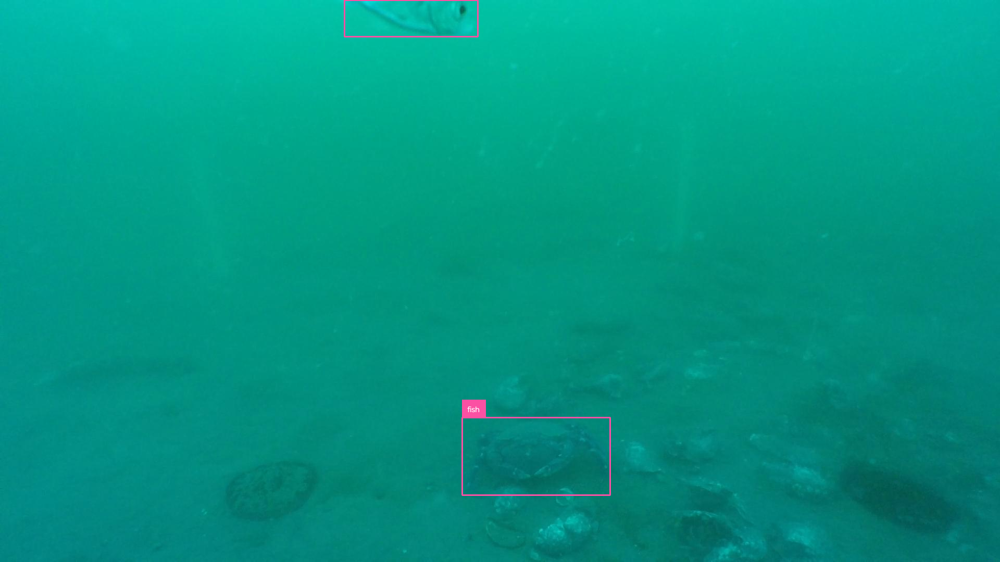

#### MIT Sea Grant River Herring

Images of freshwater fish taken from underwater videos with 91,482 bounding boxes

[Project Website](https://www.woodwellclimate.org/project/fisheye/)

- Data downloadable via via https from LILA ([download link](https://lila.science/datasets/mit-sea-grant-river-herring/))
- License: CDLA-permissive 1.0
- Metadata raw format: COCO
- Categories/species: river herring (alewife and blueback), trout, perch, bass, eel, lamprey, sunfish, pickerel, unknown fish
  - fish: river_herring, trout, perch, bass, eel, lamprey, sunfish, pickerel
  - non-fish: none
  - discarded: unknown_fish (images containing it are dropped)
- Vehicle type: Frames taken fromUnderwater Videos
- Image information: 262,050 images
- Annotation information: 91,482 bounding boxes
- Typical animal size in pixels: N/A
- Code to render sample annotated image: [mit_river_herring.py](./datasets/mit_river_herring.py)

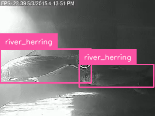

#### Tasmanian Orange Roughy Stereo Image Machine Learning Dataset (TORSI)

Annotated stereo imagery of orange roughy from 2019 Tasmanian survey, with expert-labeled bounding boxes for machine learning detection in fisheries science.

Scoulding B, Maguire K, Orenstein E, Jackett C, CSIRO.  [Tasmanian Orange Roughy Stereo Image Machine Learning Dataset](https://doi.org/10.25919/a90r-4962). v1. CSIRO. Data Collection. 2025.

- Data downloadable via via https from the CSIRO Portal ([download link](https://data.csiro.au/collection/64913))
- License: CC BY-NC-SA 4.0
- Metadata raw format: COCO
- Categories/species: fish, eel, corals and other benthic organisms.
  - fish: orange_roughy, orange_roughy_edge, misc_fish, eel, oreo, whiptail, chimera, shark
  - non-fish: sea_star, sea_urchin, brittle_star
  - discarded: mollusc, cnidaria, sea_feather, sea_anemone, coral, siphonophore
- Vehicle type: Net-attached Acoustic and Optical System (AOS)
- Image information: 1,051 images
- Annotation information: 14,414 bounding boxes
- Typical animal size in pixels: N/A
- Code to render sample annotated image: [torsi.py](./datasets/torsi.py)

#### Project Natick Underwater Video

~1k images of fish/arrow worms w/bounding boxes

Simon K. [ProjectNatick - Microsoft's Self-sufficient Underwater Datacenters](https://nbn-resolving.org/urn:nbn:de:0168-ssoar-57615-2). IndraStra Global, 4(6), 1-4. 2018.

- Data downloadable via via https from GitHub ([download link](https://github.com/Microsoft/Project_Natick_Analysis/releases/tag/annotated_data))
- Metadata raw format: Pascal VOC
- Categories/species: fish, arrow worms (labelled "Squid" in the source)
  - fish: Fish
  - non-fish: none
  - discarded: Squid (arrow worms, mostly under ~3 cm)
- Vehicle type: fixed camera on structure
- Image information: 1118 RGB images (~5% of images have FN annotations)
- Annotation information: 1,088 bounding boxes (939 fish, 149 arrow worms)
- Typical animal size in pixels: N/A
- Code to render sample annotated image: [project_natick.py](./datasets/project_natick.py)

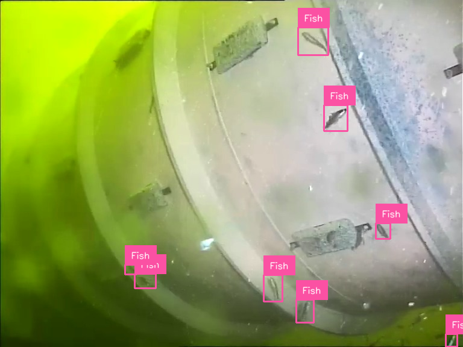

#### Roboflow Fish Dataset

~1k images of fish w/bounding boxes

Solawetz J Fish object detection dataset. Roboflow. 2023. 

- Data downloadable via via https from Roboflow ([download link](https://public.roboflow.com/object-detection/fish/1))
- License: CC0 1.0 DEED
- Metadata raw format: multiple available
- Categories/species: 26 fish types (e.g. shark, tuna); 13 fish families, each labelled once with a Latin and once with a common name
  - fish: all 26 classes
  - non-fish: none
  - discarded: none
- Vehicle type: underwater cameras
- Image information: 680 RGB images (the export contains 670 of them twice; duplicates are removed) (the taxonomy is often inaccurate)
- Annotation information: 1,582 bounding boxes after removing duplicate images
- Typical animal size in pixels: N/A
- Code to render sample annotated image: [roboflow_fish.py](./datasets/roboflow_fish.py)

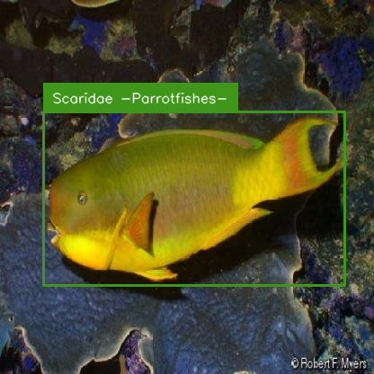

#### DeepFish

~40k images with a mix of classification, segmentation, and counting labels

Saleh A, Laradji IH, Konovalov DA, Bradley M, Vazquez D, Sheaves M. A realistic fish-habitat dataset to evaluate algorithms for underwater visual analysis. Scientific Reports. 2020 Sep 4;10(1):14671.

- Data downloadable via https from Queensland University ([download link](https://alzayats.github.io/DeepFish/)) (7.1GB)
- License: Code is MIT, data is implied-MIT
- Metadata raw format: png (segmentation masks)
- Categories/species: fish (species from tropical Australian habitats, e.g. Lutjanus, Caranx, Epinephelus, Gerres)
  - fish: fish
  - non-fish: none
  - discarded: mask noise (14 components of 1-20 px)
- Vehicle type: underwater camera deployed over the side of a boat
- Image information: 620 images used (310 with segmentation masks, 310 empty)
- Annotation information: 310 segmentation masks, 374 fish bounding boxes after connected component analysis
- Code to render sample annotated image: [deepfish.py](./datasets/deepfish.py)

#### Deep Vision Fish Dataset

Bboxed images of pelagic fish and associated segmentations

Allken V, Rosen S. [Deep Vision fish dataset](https://doi.org/10.21335/NMDC-551736490). 2020.

- Data downloadable via via https from the Norwegian Marine Data Centre ([download link](https://metadata.nmdc.no/metadata-api/landingpage/01d102345aef4639f063a13ea20cd3f3))
- License: CC BY 4.0
- Metadata raw format: csv
- Categories/species: economically important pelagic species (herring, mackerel, blue whiting, mesopelagic fish, barracudinas, salmon, lumpsucker)
  - fish: herring, mackerel, bluewhiting, mesopelagic, Sharpchin barracudina, spotted barracudina, salmon, lumpsucker
  - non-fish: none
  - discarded: none
- Vehicle type: pictures from fish tanks
- Image information: 1875 RGB images
- Annotation information: 4834 bounding boxes, segmentation masks
- Typical animal size in pixels: N/A
- Code to render sample annotated image: [deep_vision.py](./datasets/deep_vision.py)

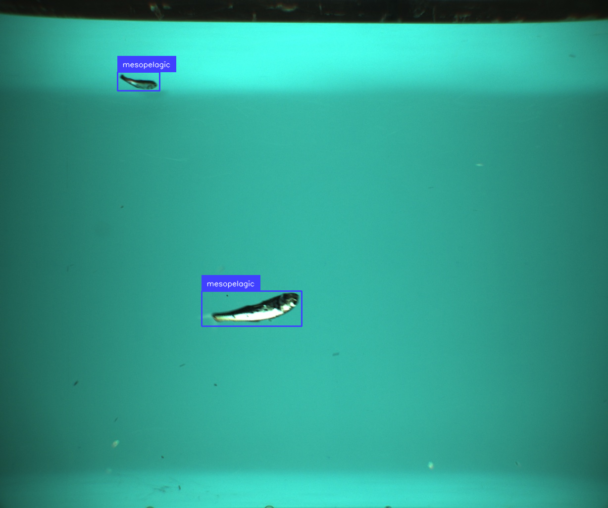

#### The Brackish Dataset

~90 videos with bounding boxes on fish.  Largely redundant with BrackishMOT (see above).

Pedersen M, Haurum JB, Gade R, Moeslund TB, Madsen N.  Detection of Marine Animals in a New Underwater Dataset with Varying Visibility. 2019.

- Data downloadable via via https from Kaggle ([download link](https://www.kaggle.com/datasets/aalborguniversity/brackish-dataset))
- License: CC BY-SA 4.0
- Metadata raw format: AAU, COCO, YOLO
- Categories/species: fish, small fish, crab, shrimp, jellyfish, starfish
  - fish: `fish`, `small_fish`
  - non-fish: `crab`, `starfish`, `jellyfish`, `shrimp`
  - discarded: none
- Vehicle type: underwater cameras in brackish water
- Image information: 12,444 RGB images
- Annotation information: 35,565  bounding boxes
- Typical animal size in pixels: N/A
- Code to render sample annotated image: [brackish.py](./datasets/brackish.py)

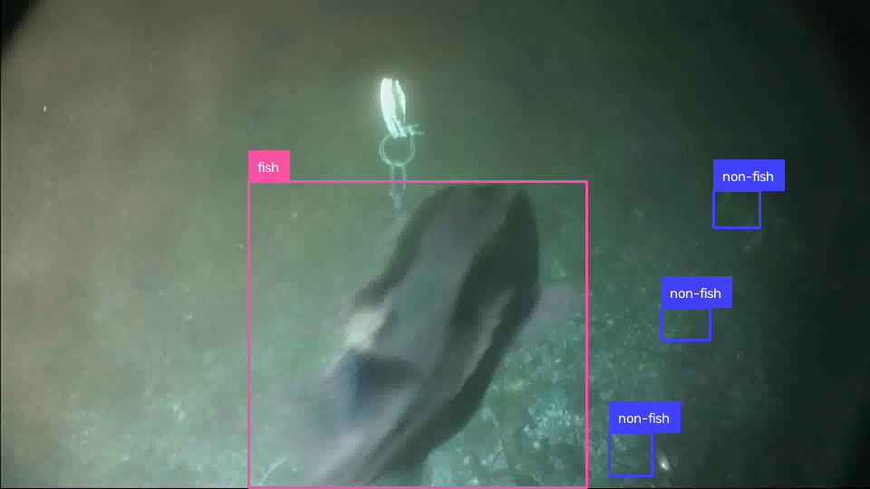

#### F4K Detection and Tracking

17 10-minute videos with tracking points

Kavasidis I, Palazzo S, Di Salvo R, Giordano D, Spampinato C. An innovative web-based collaborative platform for video annotation, Multimedia Tools and Applications. 2013.

Kavasidis I, Palazzo S, Di Salvo R, Giordano D, Spampinato C. A semi-automatic tool for detection and tracking ground truth generation in videos. Proceedings of the 1st International Workshop on Visual Interfaces for Ground Truth Collection in Computer Vision Applications. 2012.

- Data downloadable via https from GitHub ([download link](https://github.com/perceivelab/f4k-detection-and-tracking))
- Metadata raw format: XML, FLV
- Categories/species: fish, plus background regions (open sea, sea, rocks, coral, plant, dark area, algae, other)
  - fish: `fish`
  - non-fish: none
  - discarded: `open_sea`, `sea`, `rocks`, `coral`, `plant`, `dark_area`, `other`, `algae`
- Vehicle type: N/A
- Image information: N/A
- Annotation information: N/A
- Typical animal size in pixels: N/A
- Code to render sample annotated image: [f4k.py](./datasets/f4k.py)

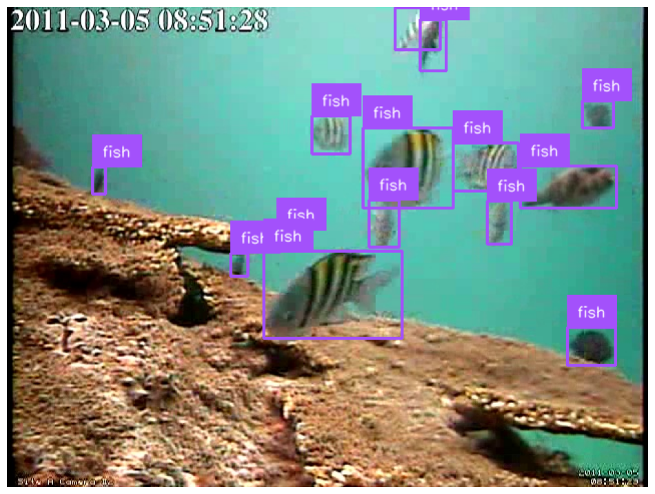

#### FishCLEF-2015

14k boxes on fish in 20k images

Joly A, Goeau H, Glotin H, Spampinato C, Bonnet P, Vellinga W-P, Planquè R, Rauber A, Palazzo S, Fisher R.  LifeCLEF 2015: multimedia life species identification challenges, International Conference of the Cross-Language Evaluation Forum for European Languages. 2015.

- Data downloadable via https from Zenodo ([download link](https://zenodo.org/records/15202605/files/fishclef_2015_release.zip?download=1)). Note, the dataset was [originally hosted on SharePoint](https://github.com/perceivelab/FishCLEF-2015). We uploaded it to Zenodo to make it downloadable programmatically.
- Metadata raw format: XML
- Categories/species: marine ray-finned fish (29 reef fish species names, e.g. Dascyllus reticulatus, Chaetodon lunulatus, Amphiprion clarkii)
  - fish: all 29 species names, including `NULL` (unidentified fish)
  - non-fish: none
  - discarded: none
- Vehicle type: N/A
- Image information: 20,000 images
- Annotation information: 14,000 bounding boxes
- Typical animal size in pixels: N/A
- Code to render sample annotated image: [fishclef.py](./datasets/fishclef.py)

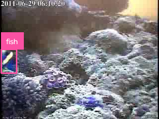

#### VIAME FishTrack (FishTrack23)

~308,000 frames from 576 underwater videos and image sequences with fish tracks, from NOAA SEFSC (SEAMAP reef fish video survey, Gulf of Mexico), NOAA PIFSC (MOUSS, Hawaii), Ifremer (baited DropCam and Game of Trawls, Bay of Biscay) and CDFW (LakeCam, California reservoir)

- Paper: Dawkins et al., "FishTrack23: An Ensemble Underwater Dataset for Multi-Object Tracking", WACV 2024 ([paper](https://openaccess.thecvf.com/content/WACV2024/papers/Dawkins_FishTrack23_An_Ensemble_Underwater_Dataset_for_Multi-Object_Tracking_WACV_2024_paper.pdf))
- Data downloadable from Viame ([download link](https://viame.kitware.com/#/collection/65a140e8a4c218785d408b42))
- Metadata raw format: VIAME CSV (tracks)
- Categories/species: 155 labels, mostly fish species (148 fish species/genera/families, unspecified fish, crabs, other animals, bait and plants)
  - fish: all fish species, genus and family labels (e.g. `lutjanus_campechanus`, `micropterus_salmoides`, `etelis_coruscans`) and `unspecified_fish`
  - non-fish: `anomura` (squat/hermit crabs), `stenocionops_spinimana` (spider crab), `non_fish_animal`
  - discarded: `non_fish_bait`, `non_fish_bait_apparatus`, `non_fish_plant`
- Vehicle type: Baited and unbaited stationary cameras (BRUV, camera arrays, drop cameras), trawl camera
- Image information: ~308,000 frames with fish or non-fish boxes (1280x720 to 1920x1200, part greyscale), annotated at 5-30 Hz (consecutive frames are near-duplicates)
- Annotation information: ~725,000 bounding boxes in ~19,000 tracks
- Code to render sample annotated image: [viame_fishtrack.py](./datasets/viame_fishtrack.py)

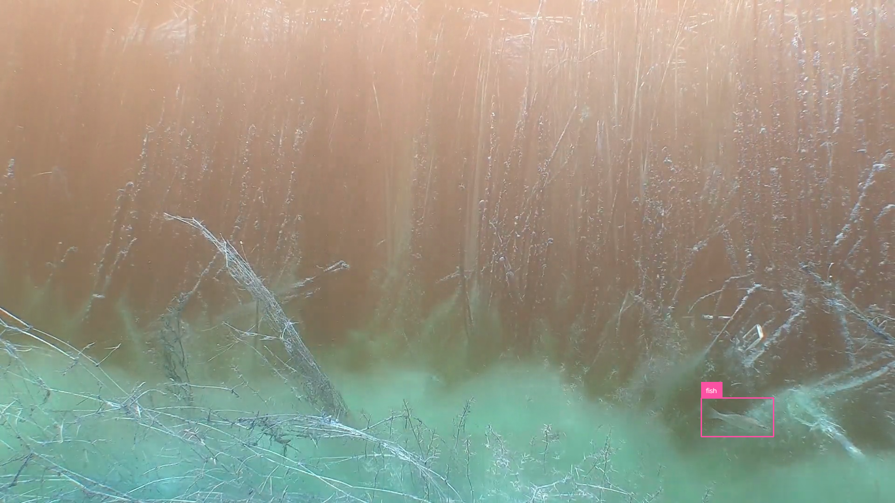

#### Object detection of tropical freshwater fish in Australia (Kakadu)

~44k images of fish w/ ~83kbounding boxes

Jansen A, Walden D, Walker S, Buccella C.  [A deep learning dataset for underwater object detection of tropical freshwater fish species in northern Australia](https://doi.org/10.5281/zenodo.7250921) (dataset).  2022.

- Data downloadable via https from zenodo ([download link](https://zenodo.org/records/7250921#.ZEAmZezMJqs))
- License: CC BY 4.0 LEGAL CODE
- Metadata raw format: json
- Categories/species: Ambassis agrammus, Ambassis macleayi, Amniataba percoides, Craterocephalus stercusmuscarum, Denariusa bandata, Glossamia aprion, Glossogobius spp., Hephaestus fuliginosus, Lates calcarifer, Leiopotherapon unicolor, Liza ordensis, Megalops cyprinoides, Melanotaenia nigrans, Melanotaenia splendida inornata, Mogurnda mogurnda, Nemetalosa erebi, Neoarius spp., Neosilurus spp., Oxyeleotris spp., Scleropages jardinii, Strongylura kreffti, Syncomistes butleri, Toxotes chatareus
  - fish: all 23 species
  - non-fish: none
  - discarded: none
- Vehicle type: RUV
- Image information: 44,112 images (images were derived from Remote Underwater Video (RUV) deployments in deep channel and shallow lowland billabongs, Kakadu National Park, Northern Territory Australia)
- Annotation information: 82,904 bounding boxes
- Typical animal size in pixels: N/A
- Code to render sample annotated image: [kakadu.py](./datasets/kakadu.py)

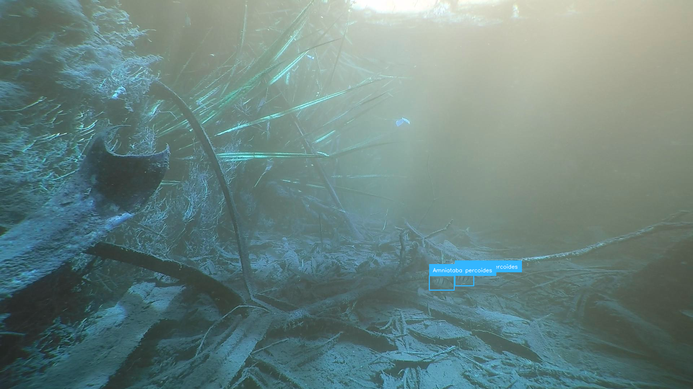

#### AAU Zebrafish Re-Identification Dataset

2200 images of zebrafish with individual IDs

Bruslund HJ, Karpova A, Pedersen M, Hein BS, Moeslund TB. Re-identification of zebrafish using metric learning. InProceedings of the IEEE/CVF winter conference on applications of computer vision workshops. 2020.

- Data downloadable via https from Kaggle ([download link](https://www.kaggle.com/datasets/aalborguniversity/aau-zebrafish-reid))
- License: CC BY 4.0 DEED
- Metadata raw format: csv
- Categories/species: zebrafish
  - fish: Zebrafish
  - non-fish: none
  - discarded: none
- Vehicle type: underwater camera in fish tank
- Image information: 2224 images
- Annotation information: AAU VAP bounding boxes
- Typical animal size in pixels: N/A
- Code to render sample annotated image: [zebrafish.py](./datasets/zebrafish.py)

#### FathomNet Database

Katija K, Orenstein E, Schlining B, et al. [FathomNet: A global image database for enabling artificial intelligence in the ocean](https://doi.org/10.1038/s41598-022-19939-2). Sci Rep 12, 15914 (2022).

The FathomNet Database is an open-source image database that can be used to train, test, and validate state-of-the-art artificial intelligence algorithms to help us understand our ocean and its inhabitants. 

- Data downloadable via https from FathomNet ([website](https://fathomnet.org/))
- License: CC BY-NC-ND 4.0 with provision: *Notwithstanding any contrary provisions of such license, all Images may be used for training and development of machine learning algorithms for commercial, academic, and government purposes. For all other uses of the Images, users should contact the original copyright holder indicated in the Database for the applicable Images. The users of the Images accept full responsibility for their use.* ([source](https://fathomnet.org/fathomnet/#/license))
- Metadata raw format: N/A (exportable via [fathomnet-py](https://github.com/fathomnet/fathomnet-py) to VOC, COCO, YOLO)
- Categories/species: many (2400+ concepts in the database)
  - fish: Actinopterygii, Sarcopterygii, Chondrichthyes, Agnatha concepts, plus common names such as bony fish, shark, ray or skate
  - non-fish: motile animals > ~3 cm: marine mammals, turtles, seabirds, sea stars, brittle stars, urchins, sea cucumbers, feather stars, decapods, cephalopods, large snails and sea slugs, large jellies, comb jellies (Lobata, Beroida), large sea spiders and isopods
  - discarded: corals, sponges, anemones and other sessile animals, worms, tunicates, siphonophores, small jellies, small crustaceans and snails, generic labels (marine organism), algae, equipment. Full concept list in [fathomnet_categories.json](./datasets/fathomnet_categories.json)
- Vehicle type: primarily ROV
- Image information: 100k+ images (growing over time)
- Annotation information: 300k+ annotations (growing over time)
- Typical animal size in pixels: N/A
- Code to render sample annotated image: [fathomnet.py](./datasets/fathomnet.py)

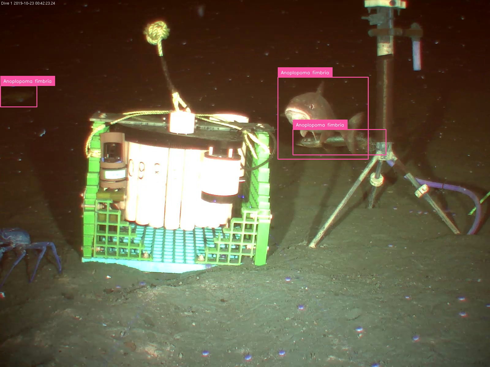

#### Marine Detect (FishInv and Megafauna)

Two Roboflow datasets with bounding boxes on fish, sharks, rays, turtles and other reef species

- Data downloadable via https from Azure blob storage ([FishInv](https://stpubtenakanclyw.blob.core.windows.net/marine-detect/FishInv-dataset.zip), [MegaFauna](https://stpubtenakanclyw.blob.core.windows.net/marine-detect/MegaFauna-dataset.zip))
- Metadata raw format: YOLO
- Categories/species: fish, shark, ray, turtle, various reef fish families, and reef invertebrates
  - fish: `fish`, `bolbometopon_muricatum`, `chaetodontidae`, `cheilinus_undulatus`, `cromileptes_altivelis`, `haemulidae`, `lutjanidae`, `muraenidae`, `scaridae`, `serranidae`, `shark`, `ray`
  - non-fish: `turtle`, `urchin`, `sea_cucumber`, `crown_of_thorns`, `lobster`
  - discarded: `giant_clam` (sessile)
- Vehicle type: underwater cameras
- Code to render sample annotated image: [marine_detect.py](./datasets/marine_detect.py)

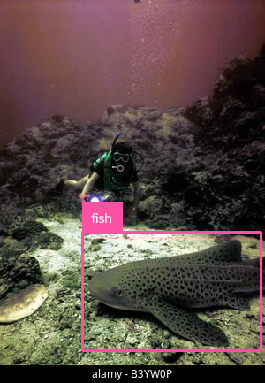

#### Salmon Computer Vision

Boxes on 532,000 frames from 1,567 videos of salmon in two weirs

Atlas WI, Ma S, Chou YC, Connors K, Scurfield D, Nam B, Ma X, Cleveland M, Doire J, Moore JW, Shea R. Wild salmon enumeration and monitoring using deep learning empowered detection and tracking. Frontiers in Marine Science. 2023 Sep 20.

- Data downloadable via https from Dropbox, linked from GitHub ([download link](https://github.com/Salmon-Computer-Vision/salmon-computer-vision), file `yolov6_salmon.tar.gz`, ~107 GB)
- License: CC BY-NC-SA 4.0
- Metadata raw format: YOLOv6
- Categories/species: Pacific salmon and other river fish (Coho, Shiner, Bull trout, Pikeminnow, Pink, Rainbow trout, Whitefish, Chinook, Sockeye, Chum, Jack Chinook, juvenile salmonids, Steelhead)
  - fish: all 16 classes
  - non-fish: none
  - discarded: none
- Vehicle type: fixed underwater cameras at river weirs (Kitwanga River, Bear Creek)
- Image information: 1,391,168 video frames (1920x1080) from 1,673 videos; every frame is labelled, 962k frames have no fish
- Annotation information: 480,058 bounding boxes
- Typical animal size in pixels: ~1100x500 (median box)
- Code to render sample annotated image: [salmon_computer_vision.py](./datasets/salmon_computer_vision.py)

### Datasets that were added after the most recent CFD training

#### PomerFish

Underwater video surveillance of freshwater fish species collected 2015–2024 in Pomeranian rivers using GoPro Hero 5 cameras.

Shi, X., Tanwari, K. A., Krepski, T., Shi, Z., & Czerniawski, R. (2025). PomerFish: A dataset for fishes across Pomerania freshwater waterbodies in-situ environments. Zenodo. [https://doi.org/10.5281/zenodo.17432128](https://doi.org/10.5281/zenodo.17432128)

- Data downloadable via HTTPS from Zenodo ([download link](https://zenodo.org/records/17432128/files/PomerFish.rar?download=1))
- License: CC-BY-4.0
- Metadata raw format: COCO JSON
- Categories/species: Perca fluviatilis, Thymallus thymallus, Salmo trutta (male/female), Salmoninae (Juvenile), Salmo trutta morpha fario (Adult/juvenile), Rutilus rutilus, Oncorhynchus mykiss, Leuciscus idus
- Vehicle type: GoPro Hero 5 (in-situ freshwater)
- Image information: 14,989 images
- Annotation information: 21,267 bounding boxes
- Typical animal size in pixels: N/A
- Code to render sample annotated image: [pomerfish.py](./datasets/pomerfish.py)

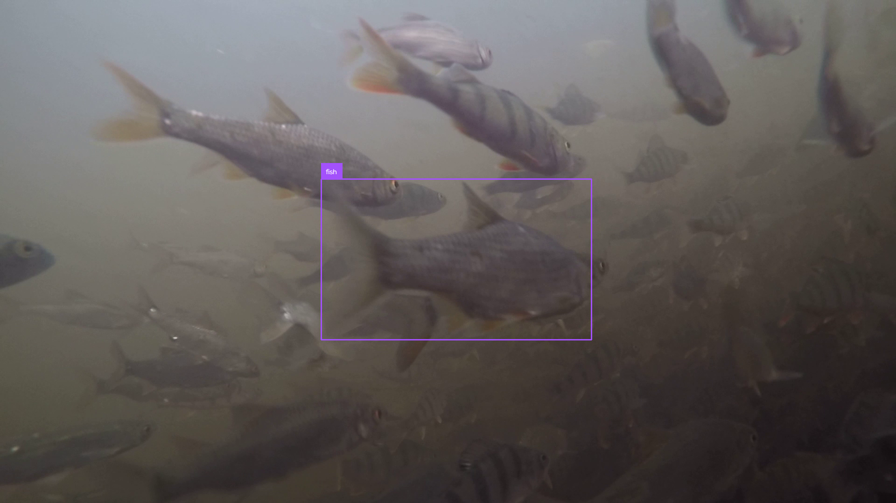

#### OBSEA

Boxes on fish and other objects in images from the OBSEA seafloor observatory in the Mediterranean

- Data downloadable via Zenodo ([download link](https://doi.org/10.5281/zenodo.14888328))
- License: CC BY 4.0
- Metadata raw format: YOLO
- Categories/species: 74 source classes (Mediterranean fish species, plus a few other animals, divers and seagrass)
  - fish: 65 classes (all fish species and their variants, plus unknown and unknown sp)
  - non-fish: crab (Cranc), Octopus vulgaris, jellyfish (Rhizostoma pulmo, Chrysaora hysoscella), starfish (Asteroidea)
  - discarded: Diver, Delphinus (dead) (a carcass on the seabed), Posidonia oceanica (seagrass), Gateropodae (small snail shells)
- Vehicle type: fixed underwater observatory camera
- Image information: 4,120 images, including 413 images with no boxes
- Annotation information: 34,728 fish and 184 non-fish bounding boxes
- Typical animal size in pixels: ~65 (median long side of the fish boxes)
- Code to render sample annotated image: [obsea.py](./datasets/obsea.py)

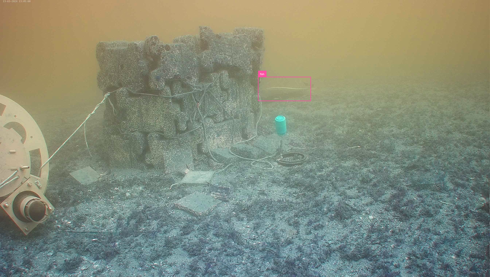

#### CoralscapesV2

2,433 densely annotated frames from diver-borne cameras at 41 Red Sea reef sites (55 per the project page), with 95-class semantic segmentation and 65,738 fish instance masks. Extends Coralscapes v1, which is no longer processed separately.

Sauder J, Ruckli T, Strodomskyte G, et al. [CoralscapesV2: Panoptic and Fine-Grained Visual Scene Understanding in Coral Reefs](https://arxiv.org/pdf/2609.12826). ECCV 2026 Workshop on Marine Vision.

- Home: [https://josauder.github.io/coralscapesv2/](https://josauder.github.io/coralscapesv2/)
- Data downloadable via HuggingFace from [https://huggingface.co/datasets/josauder/coralscapesV2](https://huggingface.co/datasets/josauder/coralscapesV2)
- License: Apache-2.0
- Metadata raw format: Parquet (images, semantic masks, fish instance masks)
- Categories/species: fish, crown-of-thorns starfish, sea cucumbers, sea urchins, other animals (mostly sea turtles), corals, substrate, divers, etc. (95 classes)
  - fish: fish
  - non-fish: acanthaster planci (crown-of-thorns starfish), sea cucumber, other animal
  - discarded: sea urchin (clustered urchins have no instance masks), giant clams, anemones, feather worms, sponges, humans, corals, substrate and the other background classes
- Vehicle type: diver
- Image information: 2,433 images (2048x1024)
- Annotation information: 65,738 fish instance masks; 330 non-fish boxes derived from the semantic masks
- Typical animal size in pixels: fish ~22 px (median box long side)
- Code to render sample annotated image: [coralscapes_v2.py](./datasets/coralscapes_v2.py)

#### Orange Chromide Pond Fish Detection

586 annotated underwater images of Orange Chromide (Etroplus maculatus) fish in South Indian pond environments with 10,607 bounding boxes

Vijayalakshmi M, Sasithradevi A.  [Annotated underwater fish detection dataset from pond environments](https://doi.org/10.17632/7w45jx35hd.1). 2024

- Data downloadable via https from Mendeley Data ([download link](https://data.mendeley.com/datasets/7w45jx35hd/1))
- License: CC BY 4.0
- Metadata raw format: YOLO TXT
- Categories/species: Orange Chromide (Etroplus maculatus); other cichlids and koi in the same ponds are boxed with the same class
  - fish: the single class (all fish)
  - non-fish: none
  - discarded: none
- Vehicle type: Crosstour CT9000 underwater camera at <4m depth
- Image information: 586 images (640x640)
- Annotation information: 10,607 bounding boxes
- Typical animal size in pixels: N/A
- Code to render sample annotated image: [orange_chromide.py](./datasets/orange_chromide.py)

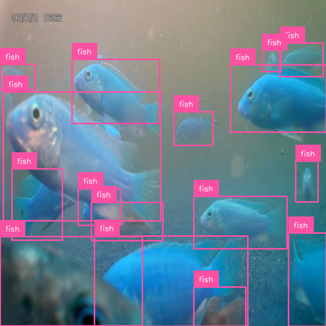

#### PEBL Seaweed and Shellfish Farm Fauna

1,035 still frames from fixed underwater cameras on two UK seaweed and shellfish farms (turbid, temperate water) with 2,464 bounding boxes on fish and other animals

PEBL CIC (2026). PEBL Seaweed and Shellfish Farm Fauna. LILA BC.

- Data downloadable via https from LILA BC ([download link](https://lilawildlife.blob.core.windows.net/lila-wildlife/community-fish-detection-dataset/pebl_farm_fauna_v1.0.zip))
- License: N/A
- Metadata raw format: COCO Camera Traps JSON
- Categories/species: fish, small bottom fish (gobies, dragonets), flatfish, hermit crabs, crabs, jellyfish, starfish, gastropods (elasmobranch, squid and shrimp categories have no boxes yet)
  - fish: Fish, Scooter (gobies and dragonets), Flatfish, Elasmobranch
  - non-fish: Hermit crab, Crab, Jellyfish, Starfish, Gastropod, Squid, Shrimp
  - discarded: none
- Vehicle type: fixed underwater cameras (PEBL SubCam), 2020, 2024 and 2026 deployments
- Image information: 1,035 images (1920x1080 and 1080x1920) from 57 videos at 5 cameras
- Annotation information: 2,464 bounding boxes (1,307 fish, 1,157 non-fish), drawn by people or detector proposals verified by a person
- Typical animal size in pixels: N/A
- Code to render sample annotated image: [pebl_farm_fauna.py](./datasets/pebl_farm_fauna.py)

#### CoReFish (Caribbean Coral Reef Fish)

Expert-annotated fish boxes and tracks in diver-transect videos from 5 coral reef sites in the US Virgin Islands National Park (St. John), surveyed every year from 2016 to 2023

Cai L, Greene A, Yang D, Aoki N, Jarriel SD, Ha J, Formel N, Mooney TA, Girdhar Y. [Species-level Detection and Tracking of Caribbean Coral Reef Fish](https://warplab.github.io/corefish/static/pdf/iccvw-corefish.pdf). ICCV 2025 Workshops (CV4Ecology).

- Home: [https://warplab.github.io/corefish/](https://warplab.github.io/corefish/)
- Data downloadable via HTTPS from Google Drive ([download link](https://drive.google.com/file/d/1LENr6D8XW8ivusF2riS0v27Grwa1Uj2q/view?usp=sharing), 40 GB zip)
- License: CC BY-NC-SA 4.0
- Metadata raw format: COCO JSON (fish-only and species-level files), YOLO TXT
- Categories/species: fish; 54 Caribbean reef fish species on a subset of tracks
  - fish: fish (the species labels are all fish and are not used)
  - non-fish: none
  - discarded: none
- Vehicle type: diver (Olympus PEN E-PL5 on a PVC transect frame)
- Image information: 14,580 frames (1920x1080) from 162 transects, 3,652 of them without fish; 14,490 used (one transect's images are missing from the zip)
- Annotation information: 100,074 bounding boxes (100,003 used)
- Typical animal size in pixels: ~29 px (median box long side)
- Code to render sample annotated image: [corefish.py](./datasets/corefish.py)

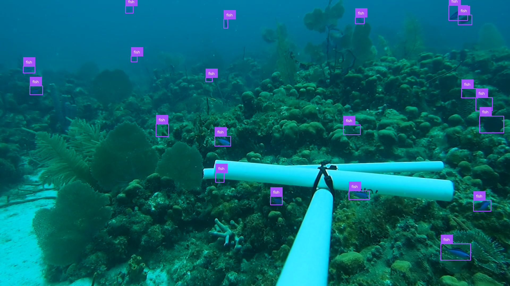

#### FjordFish

3,002 images of North Atlantic coastal fish from baited and unbaited remote underwater video surveys along the Norwegian and Swedish coasts, a cod mesocosm at the Flødevigen research station, and diver photos, with 6,350 bounding boxes in 27 classes

Poling JD, Sørdalen TK, Halvorsen K, Thormar J, Perry D, Larsen T. [FjordFish](https://doi.org/10.5281/zenodo.17950781). Zenodo, 2025. Described in: Poling JD, Perry D, Halvorsen KT, Malde K, Thormar J, Larsen T, Sørdalen TK. [Annotation strategy trade-offs for deep learning-based underwater fish detection](https://doi.org/10.1016/j.ecoinf.2026.103891). Ecological Informatics, 2026

- Data downloadable via https from Zenodo ([download link](https://zenodo.org/records/17950781/files/FjordFish.zip?download=1))
- License: CC BY 4.0
- Metadata raw format: YOLO TXT
- Categories/species: wrasses (ballan, cuckoo, corkwing, goldsinny, rock cook), gadids (cod, haddock, pollack, poor cod, saithe, whiting, ling), spiny dogfish, gobies, crabs and lobster (27 classes)
  - fish: ballan, cuckoo_female, cuckoo_male, corkwing_female, corkwing_male, goldsinny, rock_cook, labrids_unknown, cod, cod_yoy, haddock, pollack, poor_cod, saithe, whiting, gadines_unknown, spiny_dogfish, sharks_unknown, ling, two_spot_goby, black_goby, sand_goby
  - non-fish: brown_crab, green_crab, hermit (hermit crab), lobster, decapods_unknown
  - discarded: unknown (no boxes)
- Vehicle type: BRUV / stationary cameras, mesocosm camera, diver
- Image information: 3,002 images (mostly 1920x1080; also 2448x2048, 3840x2160 and diver photos up to 7360x4912)
- Annotation information: 6,350 bounding boxes (6,101 fish, 249 non-fish)
- Typical animal size in pixels: N/A
- Code to render sample annotated image: [fjordfish.py](./datasets/fjordfish.py)

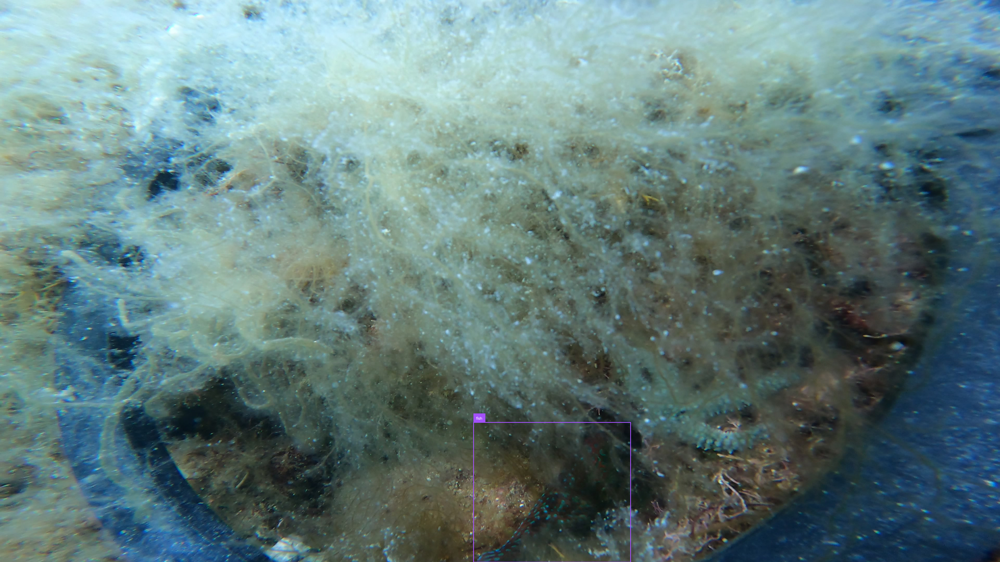

#### Newfoundland Marine Refuge Fish Classification Dataset (N-MARINE)

23,936 frames from baited, lit cameras on crab pots at 400-500 m depth in the Northeast Newfoundland Slope Closure (Canada), with 23,890 boxes on 8 groundfish species and whelks

Morris CJ, Ayyagari KD, Porter D, Nguyen QK, Hanlon J, Whidden C. [Newfoundland Marine Refuge Fish Classification Dataset (N-Marine)](https://open.canada.ca/data/en/dataset/2ae46860-f82a-4127-bb1f-b02e36ef6a70). Government of Canada Open Data Portal. 2025.

- Data downloadable via HTTPS from the Government of Canada Open Data Portal ([download link](https://open.canada.ca/data/en/dataset/2ae46860-f82a-4127-bb1f-b02e36ef6a70)): 15 PNG zips (~23 GB) and `nmarine_csv.zip`
- License: Open Government Licence - Canada
- Metadata raw format: one CSV per video (pixel corner coordinates and YOLO-style normalised boxes)
- Categories/species: Atlantic cod, roughhead grenadier, Atlantic halibut, deepwater redfish, thorny skate, striped wolffish, spinytail skate, northern wolffish, whelk
  - fish: Cod, Roughhead_grenadier, Atlantic_halibut, Redfish_mentella, Thorny_skate, Striped_wolffish, Spinytail_skate, Wolffish (northern wolffish)
  - non-fish: Whelk (Buccinum undatum)
  - discarded: none
- Vehicle type: baited camera with lights on crab pots (4 cameras, 185 five-minute videos)
- Image information: 23,936 images (1920x1080), including 3,000 background images without animals
- Annotation information: 23,890 bounding boxes (23,021 fish, 869 non-fish)
- Typical animal size in pixels: ~390 px (median box long side)
- Code to render sample annotated image: [n_marine.py](./datasets/n_marine.py)

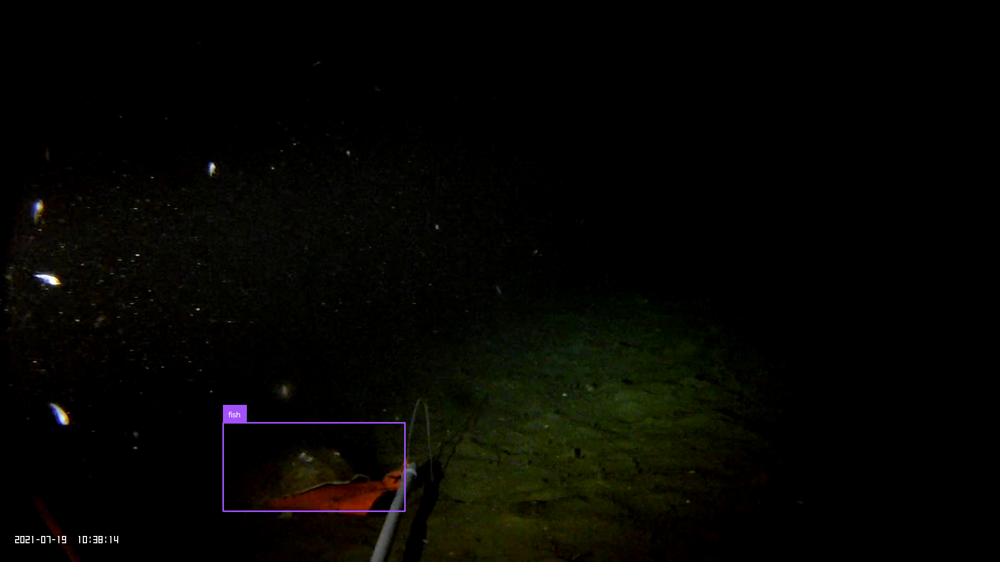

#### WIO-ReefFish

1,000 ultra-high-definition frames from diver-operated video transects on coral reefs in Kenya (2023) and Tanzania (2025), with 6,768 boxes on fish of 24 reef fish families

Gerard J, Branger L, Huyghe F, Kochzius M, Otwoma L, Bergacker S, op't Roodt L, Rumisha C, Di Bella L (2026). [WIO-ReefFish: A High-Resolution Dataset for Taxon-Aware Coral Reef Fish Detection in the Western Indian Ocean](https://doi.org/10.5281/zenodo.21360120). Zenodo.

- Data downloadable via HTTPS from Zenodo ([download link](https://zenodo.org/records/21360120/files/WIO-ReefFish_v1.0.0.zip?download=1))
- License: CC BY 4.0
- Metadata raw format: YOLO TXT
- Categories/species: 23 reef fish families and the parrotfish subfamily Scarinae (only fish of these families are boxed)
  - fish: all 24 classes (Acanthuridae, Anthiadidae, Aulostomidae, Balistidae, Caesionidae, Chaetodontidae, Epinephelidae, Haemulidae, Holocentridae, Kyphosidae, Labridae, Lethrinidae, Lutjanidae, Microdesmidae, Monacanthidae, Mullidae, Pempheridae, Pomacanthidae, Pomacentridae, Priacanthidae, Scarinae, Siganidae, Tetraodontidae, Zanclidae)
  - non-fish: none
  - discarded: none
- Vehicle type: diver (GoPro, line-intercept transects)
- Image information: 1,000 images (3840x2160) from 10 locations
- Annotation information: 6,768 bounding boxes
- Typical animal size in pixels: ~90 px (median box long side)
- Code to render sample annotated image: [wio_reef_fish.py](./datasets/wio_reef_fish.py)

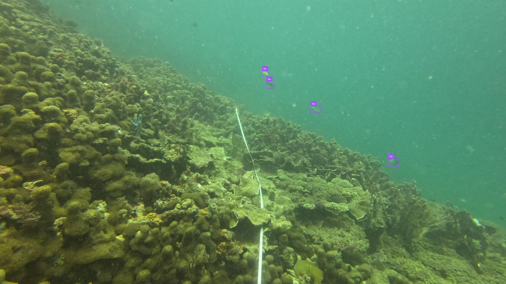

#### DIGI4ECO Underwater Fish Tracking

5,849 frames from 4 underwater videos recorded at three European marine observatory sites (Adriatic Sea, NW Mediterranean, Galway Bay), with 114,207 fish bounding boxes from manually annotated tracks

González-Villà S, Burns Font D, Aguzzi J, et al. [DIGI4ECO Underwater Fish Tracking Dataset](https://doi.org/10.5281/zenodo.20701225). Zenodo, 2026

- Data downloadable via Zenodo ([download link](https://zenodo.org/records/20701225/files/DIGI4ECO_tracking_dataset.zip?download=1))
- License: CC BY 4.0
- Metadata raw format: CVAT XML for video 1.1 (multi-object tracks) over MP4 videos
- Categories/species: Fish (all individuals, no species), plus 2 tracks labelled Apogon sp (cardinalfish)
  - fish: Fish, Apogon sp
  - non-fish: none
  - discarded: none
- Vehicle type: fixed underwater cameras (OBSEA cabled observatory, SmartBay Observatory, and a camera near an artificial structure offshore Pineto, Adriatic Sea)
- Image information: 5,849 frames (1920x1080, OBSEA 1912x1080): Ancona 1,200, OBSEA 148, SmartBay1 2,400, SmartBay2 2,101
- Annotation information: 114,207 fish bounding boxes (491 tracks); the 11,798 boxes flagged as occluded are dropped, as most of them show no visible fish
- Typical animal size in pixels: ~104 (median long side of the fish boxes)
- Code to render sample annotated image: [digi4eco.py](./datasets/digi4eco.py)

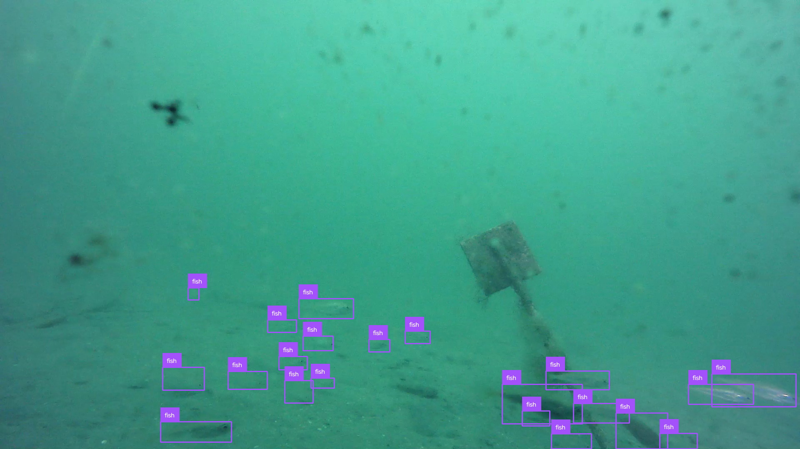

#### Labelled Mediterranean Fish Dataset (DEEPECOMAR)

1,516 underwater images of Mediterranean coastal fish (Balearic Islands, DEEPECOMAR project) from a fixed time-lapse camera on an underwater structure, diver videos and a stereo video, with 17,157 fish bounding boxes in 20 species plus unidentified and very small fish

Catalán I, Alvarez-Ellacuria A. [Labelled Mediterranean Fish Dataset](https://doi.org/10.5281/zenodo.7534425). Zenodo, 2023

- Data downloadable via https from Zenodo ([download link](https://zenodo.org/records/7534425/files/DEEPECOMAR_DATASET_YOLO.zip?download=1))
- License: CC BY 4.0
- Metadata raw format: YOLO TXT (Roboflow YOLOv5 export)
- Categories/species: 20 Mediterranean species (e.g. Chromis chromis, Diplodus sargus, Oblada melanura, Seriola dumerilii, Coris julis), genus-level and unidentified fish, very small fish, lens stains (25 classes)
  - fish: Afish poly (unidentified fish), Chromis chromis, Coris julis, Dentex dentex, Diplodus annularis, Diplodus puntazzo, Diplodus sargus, Diplodus sp-, Diplodus vulgaris, Epinephelus marginatus, Lithognathus mormyrus, Mugilidae prob Chelon, Mullus sp-, Oblada melanura, Pomatous salator, Sarpa salpa, Seriola dumerilii, Serranus cabrilla, Serranus scriba, Sparus aurata, Sphyraena sp-, Symphodus sp-, labrid unid-, small (fish < ~100 px²)
  - non-fish: none
  - discarded: taca (lens stain)
- Vehicle type: fixed time-lapse camera, diver video, stereo camera
- Image information: 1,516 images (1920x1080, 1280x720 and 1920x1440); 74 duplicated frames in the source are dropped
- Annotation information: 17,157 fish bounding boxes
- Typical animal size in pixels: ~62 (median long side of the fish boxes)
- Code to render sample annotated image: [deepecomar.py](./datasets/deepecomar.py)

#### Seatizen Atlas (instance segmentation subset)

1,200 coral reef and lagoon images from snorkellers, divers, a paddle board, a kitesurf and a surface robot (ASV) in the western Indian Ocean (Reunion, Mayotte, Europa Island, Mauritius), with instance polygons for fish, sea cucumbers and other reef organisms and habitats

Contini M, Illien V, Julien M, Ravitchandirane M, Russias V, Lazennec A, Chevrier T, Rintz CL, Carpentier L, Gogendeau P, et al. [Seatizen Atlas: a collaborative dataset of underwater and aerial marine imagery](https://doi.org/10.1038/s41597-024-04267-z). Scientific Data 12, 67 (2025). Data: [Seatizen Atlas image dataset v1.1.0](https://doi.org/10.5281/zenodo.13951614)

- Data downloadable via https from Zenodo ([annotations](https://zenodo.org/records/13951614/files/20241018_segmentation_annotations.json?download=1), [images.zip](https://zenodo.org/records/13951614/files/images.zip?download=1), 35 GB, of which only the 1,200 segmented images, ~0.6 GB, are read). The latest version of the record (https://zenodo.org/records/20459523) has only image-level labels
- License: CC BY 4.0
- Metadata raw format: COCO JSON (instance segmentation polygons)
- Categories/species: 37 GCRMN-based classes (fish, sea cucumbers, sea urchins, starfish, turtles, giant clams, sponges, corals, algae, seagrass, substrate, people and debris)
  - fish: Fish
  - non-fish: Sea_cucumber, Sea_urchin, Turtle, Other_starfish
  - discarded: Giant_clam, Sea_anemone, Sponges, Homo_Sapiens, Human_object, Waste, Trample, Useless, and all coral, algae, seagrass and substrate classes
- Vehicle type: snorkeller/diver, paddle board, kitesurf, autonomous surface vehicle (downward-facing GoPro and compact cameras)
- Image information: 1,200 images (1920x1080 to 5472x3648); 304 have no fish or non-fish and are kept as background; 1 is dropped because its file size does not match its annotations
- Annotation information: 9,718 bounding boxes from the instance polygons (8,494 fish, 1,224 non-fish)
- Typical animal size in pixels: ~56 (median long side of the fish boxes)
- Code to render sample annotated image: [seatizen_atlas.py](./datasets/seatizen_atlas.py)

#### AFSC Salmon and Pollock Object Detection

16,998 frames from a camera inside a commercial walleye pollock trawl in the eastern Bering Sea (2019-2020), with 84,986 boxes on pollock and Pacific salmon. Frames are consecutive 30 fps video frames from 184 two-second clips, so neighbouring frames are highly redundant

Wilson KC, Lurbur M, Yochum N (2025). [Automated fish detection in videos to support commercial fishing sustainability and innovation in the Alaska walleye pollock (Gadus chalcogrammus) trawl fishery](https://doi.org/10.1093/icesjms/fsaf168). ICES Journal of Marine Science, 82(9). Data: Alaska Fisheries Science Center (2026), [AFSC/RACE/MACE: 2019-2020 Salmon and Pollock Object Detection](https://www.fisheries.noaa.gov/inport/item/69412)

- Data downloadable via HTTPS from the NOAA public Google Cloud bucket ([browse link](https://console.cloud.google.com/storage/browser/nmfs_odp_afsc/RACE/MACE/salmon_pollock_object_detection/annotated_data)): 184 clip folders, ~17k PNG frames (~29 GB)
- License: CC0 1.0
- Metadata raw format: one custom COCO JSON per clip (with CVAT frame tags and track attributes)
- Categories/species: walleye pollock (Gadus chalcogrammus), Pacific salmon (Oncorhynchus spp.), herring, unidentified fish, other
  - fish: Pollock, Salmon, Fish, Herring
  - non-fish: none
  - discarded: Other (blurry, unclear shapes; the 76 frames containing one are dropped). Shark, Invertebrate, Krill, Occlusion, No Fish, Fish Low/Med/High, Low Light and Low Visibility have no boxes
- Vehicle type: camera (Sexton housing, Mobius2 action camera, LED lights) inside a commercial pollock trawl net (F/V Pacific Explorer)
- Image information: 16,922 images (13,254 at 1280x720, 3,668 at 1920x1080) from 7 tows, including 1,095 frames without fish
- Annotation information: 84,786 bounding boxes (73,205 pollock, 11,510 salmon, 71 other fish)
- Typical animal size in pixels: ~115 px (median box long side)
- Code to render sample annotated image: [afsc_salmon_pollock.py](./datasets/afsc_salmon_pollock.py)

#### NorFisk Dataset

12,514 underwater crops of farmed salmonids (inside net pens) and wild saithe (outside the pens) from ~49 hours of GoPro video at Norwegian fish farms (2017-2020, 1-50 m depth). **Each image is a crop around one fish with exactly one box; other fish visible in the crop are not annotated** (frequent in the crowded salmonid crops, occasional in the saithe crops).

Crescitelli AM (2020). NorFisk Dataset (version 1.1). DataverseNO. [https://doi.org/10.18710/H5G3K5](https://doi.org/10.18710/H5G3K5)

- Data downloadable via HTTPS from DataverseNO ([download link](https://dataverse.no/api/access/datafile/86889))
- License: CC0 1.0
- Metadata raw format: one CSV-style TXT per image (`file_name,class,xmin,ymin,xmax,ymax,width,height`)
- Categories/species: salmonids (farmed Atlantic salmon and trout), saithe (Pollachius virens)
  - fish: salmonid, saithe
  - non-fish: none
  - discarded: none
- Vehicle type: GoPro Hero 4/5/8 cameras inside and outside fish farm net pens
- Image information: 12,514 PNG crops (9,487 salmonid, 3,027 saithe), 101-3190 px wide (median 376)
- Annotation information: 12,514 bounding boxes (one per image)
- Typical animal size in pixels: ~225 px (median box long side, within the crop)
- Code to render sample annotated image: [norfisk.py](./datasets/norfisk.py)

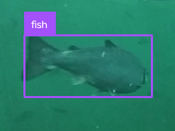

### Datasets that were not included in the Community Fish Detection Dataset

- [Fishnet.AI](https://www.fishnet.ai/): ~163k bounding boxes on ~35k images of fish and people on fishing vessels.  Excluded because images are above-water.
- [Visual Marine Animal Tracking (VMAT)](https://link.springer.com/article/10.1007/s11263-023-01762-5#article-info): 32 video sequences with bounding boxes on marine organisms from AUVs.
- [OzFish](https://github.com/open-AIMS/ozfish): Excluded due to annotation quality issues.
- [WildFish](https://github.com/PeiqinZhuang/WildFish): Excluded because images are cropped.
- [Angling Freshwater Fish Netherlands (AFFiNe)](https://www.kaggle.com/datasets/jorritvenema/affine): 7k images of 30 species, excluded because images are above water.
- [Brook trout imagery for individual ID](https://www.usgs.gov/data/brook-trout-imagery-data-individual-recognition-deep-learning): Excluded because images are above water.
- [3D-ZeF](https://huggingface.co/datasets/vapaau/3D-ZeF): Excluded because images are above water and in lab environments.
- [Croatian Fish](https://www.kaggle.com/datasets/ashfaqsyed/croatian-fish-dataset): 794 images of 12 species, excluded because images are cropped.
- [Amazonian Fish ML Classifier](https://sidatasciencelab.github.io/Amazonian_Fish_ML_Classifier/): Excluded because images are in staging environments.
- [BrackishMOT](https://www.kaggle.com/datasets/maltepedersen/brackishmot): Same data as the Brackish Dataset.
- Brackish Underwater Dataset: Same data as the Brackish Dataset.
- [CoralScapes](https://josauder.github.io/coralscapes/): 2,075 images from Red Sea coral reefs with semantic segmentation masks. Excluded because CoralscapesV2 includes all of its images but one, with more classes and fish instance masks.

### Unprocessed datasets

Datasets that we're aware exist, but that we haven't evaluated or processed yet.
- [J-EDI](https://www.godac.jamstec.go.jp/jedi/e/dataset/jedi_organism_detection_dataset.html) (~8k images with 19 deep-sea animal categories)
- [SFISHTRACK](https://github.com/JosepSanchezCano/SFISHTRACK) (~24k frames with segmentation masks)

